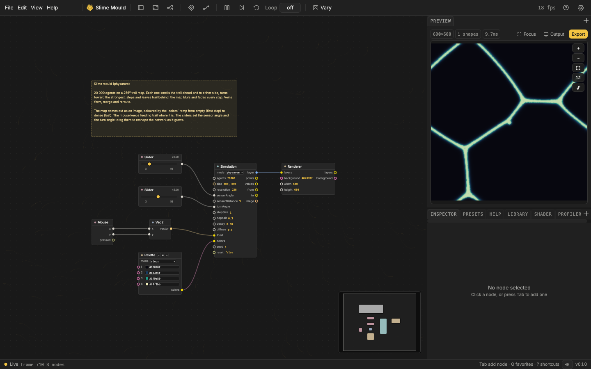
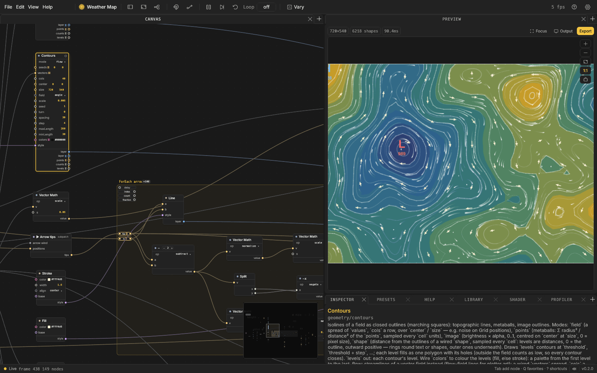
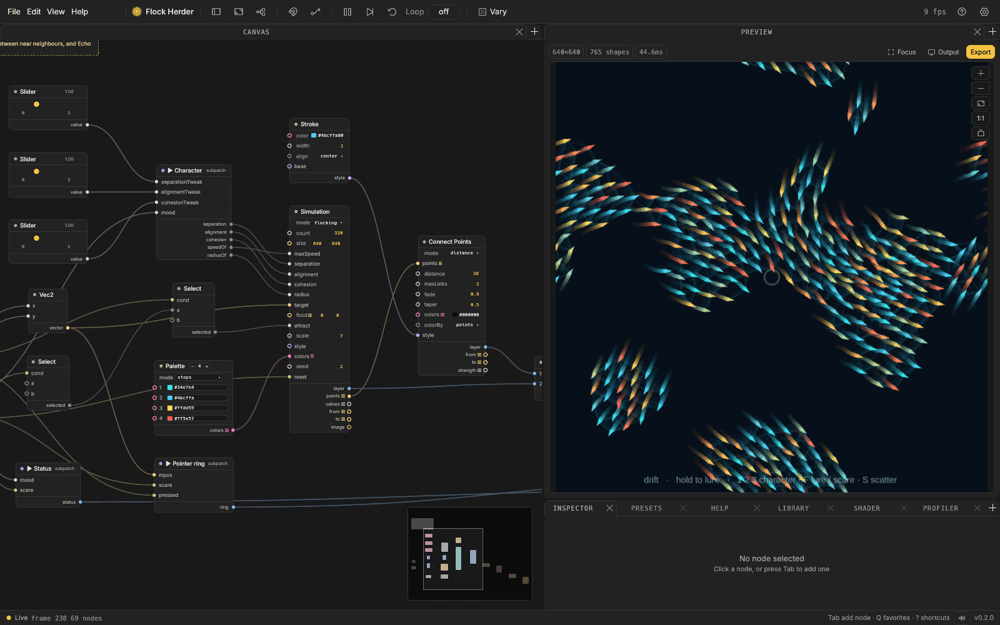
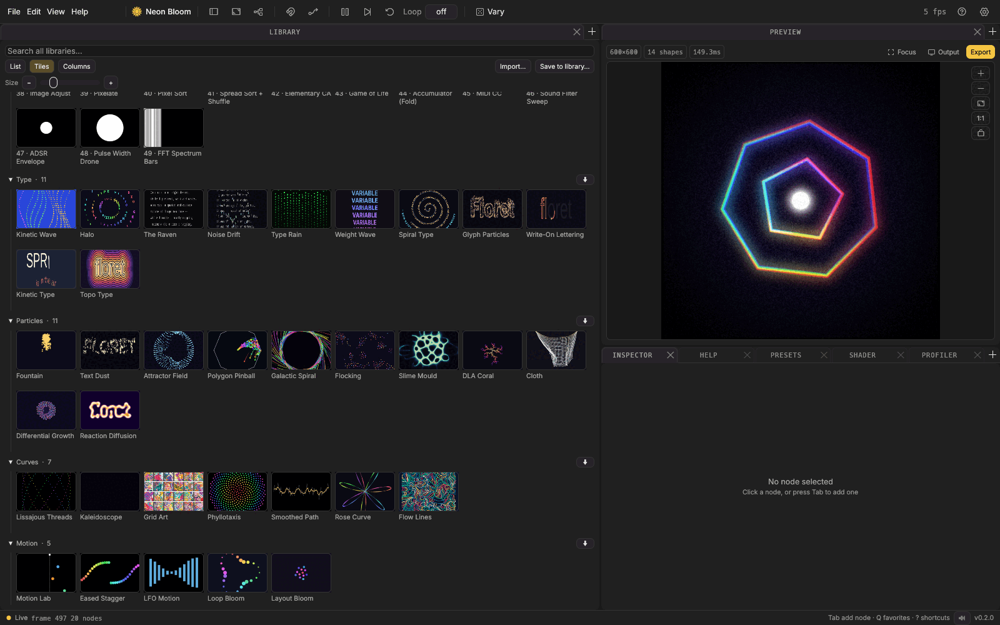
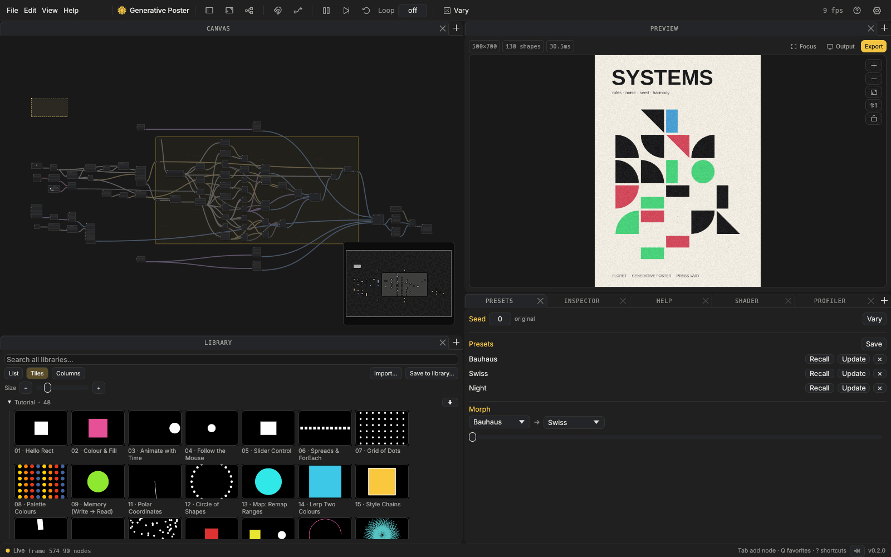

# Floret

**Floret is a free, open-source app for making generative art.** You connect
boxes (called nodes) on a canvas (shapes, motion, noise, particles, text,
images, sound) and watch the picture change as you work. No code needed.

It is a Mac app, with experimental Windows and Linux builds.

**[Download](#download)**

## What you can make

- **Patterns and textures:** flow fields, Voronoi cells, tiles, wallpaper
  symmetry, kaleidoscopes, stippling.
- **Living systems:** flocks, slime mould, coral growth, cloth, reaction
  diffusion.
- **Particles, trails and glow:** emitters, forces, bloom, grain, halftone.
- **Type and motion:** variable fonts, kinetic type, loops and easing.
- **Things that react:** to sound, MIDI, your camera, your hands and face.

You don't start from nothing: Floret comes with **175 sample patches**,
including **48 short tutorials** that each teach one idea.

## A look inside

<table>
<tr>
<td width="50%"> <b>A complex system: Weather Map.</b> Many small parts wired into a living pressure map.</td>
<td width="50%"> <b>Particles: Flock Herder.</b> 320 swimming creatures that follow, gather and leave trails.</td>
</tr>
<tr>
<td width="50%"> <b>The Library.</b> Open any sample and take it apart.</td>
<td width="50%"> <b>Your layout.</b> Panels dock, split and float wherever you like.</td>
</tr>
</table>

## Why you might like it

- **Play, don't wait.** Every value is a box you can drag or type into while
  the patch runs. Everything can be undone.
- **Easy to read.** Patches flow left to right, like a sentence, so you can
  follow what feeds what.
- **Stay tidy.** Wrap nodes into groups (subpatches), save them to your
  Library, and reuse them in any patch.
- **Find your look.** Roll new variations with one key, save the ones you
  like as presets, and morph between them.
- **Share it.** Export PNG stills, seamless loops as MP4, GIF or image
  sequences, or a contact sheet of variations.
- **Light and dark themes**, and your patches are plain files you own.

## Download

**Latest beta: [Floret v0.2.0-beta.1](https://github.com/jaerasgon/Floret/releases/tag/v0.2.0-beta.1)**
(all downloads and first-launch steps are on that page).

| Your computer | Download |
|---|---|
| **Mac with Apple silicon** (M1 or later), macOS 11 or later | [Floret for Mac (.dmg)](https://github.com/jaerasgon/Floret/releases/download/v0.2.0-beta.1/Floret-0.2.0-beta.1-macos-arm64.dmg) · [.zip](https://github.com/jaerasgon/Floret/releases/download/v0.2.0-beta.1/Floret-0.2.0-beta.1-macos-arm64.zip) |
| **Mac with an Intel chip**, macOS 11 or later | [Floret for Intel Mac (.dmg)](https://github.com/jaerasgon/Floret/releases/download/v0.2.0-beta.1/Floret-0.2.0-beta.1-macos-x86_64.dmg) · [.zip](https://github.com/jaerasgon/Floret/releases/download/v0.2.0-beta.1/Floret-0.2.0-beta.1-macos-x86_64.zip) |
| **Windows** (experimental) | [Floret for Windows (.zip)](https://github.com/jaerasgon/Floret/releases/download/v0.2.0-beta.1/Floret-0.2.0-beta.1-windows-x86_64.zip) |
| **Linux** (experimental) | [Floret for Linux (.tar.gz)](https://github.com/jaerasgon/Floret/releases/download/v0.2.0-beta.1/Floret-0.2.0-beta.1-linux-x86_64.tar.gz) |

- **The apps are not signed**, so your computer asks you to confirm the first
  launch. The steps are on the release page and in the
  [beta guide](docs/beta-testing.md).
- **Linux notes:** unpack the archive and run `./floret`. Floret needs the
  ALSA sound library; on Ubuntu: `sudo apt install libasound2`.

Want to build it yourself? See [docs/building.md](docs/building.md).

## Try it in two minutes

1. Open Floret and choose **File → Library** (Cmd+Shift+O; Ctrl
   instead of Cmd on Windows and Linux).
2. Open a sample, for example **01 · Hello Rect**. A note on the canvas
   explains the idea.
3. Drag a number in one of the boxes. The preview changes as you go.
4. Press **Cmd+Shift+R** to roll a new variation.
5. Press **Cmd+E** to save the picture as a PNG.

## Feedback and help

Floret is young, and needs your input to grow: what worked, what confused you, what you wished
it could do.

- [Report a bug](https://github.com/jaerasgon/Floret/issues/new?template=bug_report.yml)
  or [share an idea](https://github.com/jaerasgon/Floret/issues/new?template=feedback.yml)
- Or email **[Floret.make@gmail.com](mailto:Floret.make@gmail.com)**
- A `.flora` file that misbehaves, plus a sentence about what you expected,
  is perfect.

Ideas and bug reports help most when they come to the project rather than
to a fork, so Floret gets better for everyone.
[CONTRIBUTING.md](CONTRIBUTING.md) has the details.

## Support Floret

Floret is free and will stay free. If it's useful to you and you'd like to
help me keep building it, you can leave a tip on
[Ko-fi](https://ko-fi.com/jaerasgon). Feedback helps just as much.

## Licence

Free and open source under the **[Apache License 2.0](LICENSE)**: use it,
change it, build on it. If you build Floret into another tool, keep the
[NOTICE](NOTICE) file and credit Floret and its author, Jaafer Elsadig.
Third-party licences are in [THIRD_PARTY_NOTICES.md](THIRD_PARTY_NOTICES.md)
and in the app under Help → Licenses….

## More

[All 252 nodes](NODES.md) · [Beta tester guide](docs/beta-testing.md) ·
[Releases](https://github.com/jaerasgon/Floret/releases) ·
[Changelog](CHANGELOG.md) · [Security](SECURITY.md) ·
[Code of conduct](CODE_OF_CONDUCT.md)

The earlier web version of Floret is kept in `web-legacy/` for reference.
