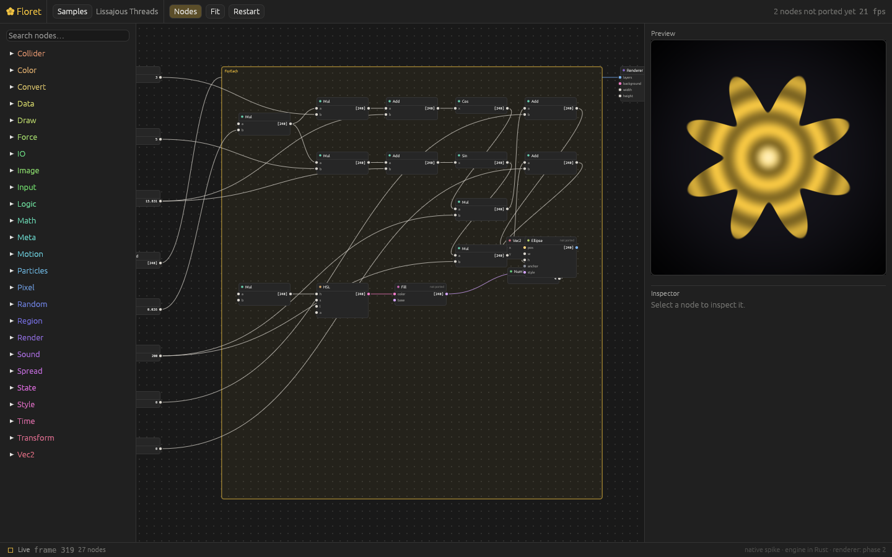

# Floret → Native Desktop App — Transition Plan

**Status:** in progress (approved 2026-10-01) · **Date:** 2026-10-01
**Decisions:** fully native desktop app — no browser layer, no Electron, no
Tauri/web view. Runs on **macOS, Windows and Linux**. The TypeScript web app
is no longer developed; it stays in the repo only as the reference
implementation the native port is checked against (golden fixtures).

Reference point: [Caddis](https://www.caddis.app/) — a vibe-coded node-based
motion tool that feels native and ships on all three platforms. Its engine
is Rust + wgpu (Metal / D3D12 / Vulkan). Floret follows the same foundation.

This replaces issue #30 ("Native kiosk shell (Electron / Tauri)", closed).

## Progress

| Phase | State |
|---|---|
| 0 · Fixtures | ✅ `npm run fixtures:export` → 95 `.flora` samples + traces in `native/` |
| 1 · Engine core | ✅ compile / tick / regions / state / constants ported; 184 node types ported (math, vec2, spread, color, motion, logic, convert, string, value, data, meta, time, input, random, noise, io controls), each checked against the TS code; ~1,500 node outputs across the samples match the reference; parity test runs in CI on macOS / Windows / Linux |
| UI spike | ✅ `native/crates/floret-app` (egui + wgpu): node canvas, palette, inspector, live engine values, GPU preview via egui's render pass. Downloadable builds from CI. **Waiting on your feel check.** |
| 2 · Scene + renderer | next: typed scene IR, styles as data, draw / style / transform nodes, wgpu renderer |
| 3–9 | not started |



---|---|
| 0 · Fixtures | ✅ `npm run fixtures:export` → 95 `.flora` samples + traces in `native/` |
| 1 · Engine core | 🟡 compile / tick / regions / state ported; parity harness in CI on all 3 OSes; node categories being ported |
| 2–9 | not started |

---

## 1. What we're porting

| | Today (TypeScript) |
|---|---|
| Code | ~44k lines TS/TSX + 5.6k lines CSS, 313 files |
| Nodes | 298 registered across 24 categories (biggest: spread-ops 56, math 44, vec2 20, sound 19, io 18, draw 14) |
| Samples | 95 (48 tutorials + 47 showcase), built in TS code, not stored as files |
| Tests | 31 files / 629 tests; 24 files are pure engine logic |
| Renderer | WebGL2: SDF shapes, stencil polygon fill, textured quads, blend layers, Gaussian blur, feedback buffers, user GLSL (ShaderToy-style) |
| Audio | Web Audio node graph, 19 sound nodes, no worklets |
| Inputs | mouse, keyboard, camera, MediaPipe hand/face/pose, MIDI, microphone |
| Files | `.flora` JSON (versioned + migrations), localStorage autosave + library |

The engine is the valuable, portable part: compile → topo sort → tick with
regions (ForEach / If / Cache / subpatch), cross-frame state, spreads,
retained-mode scene IR. Most node files (107 of 135) are pure logic with no
browser calls.

---

## 2. Target stack — Rust, one codebase, three platforms

| Concern | Web today | Native (Rust) |
|---|---|---|
| Language | TypeScript | **Rust** |
| GPU | WebGL2 | **wgpu** → Metal (Mac), D3D12 (Windows), Vulkan (Linux) |
| UI framework | React + React Flow | **egui** (see §7.1), drawn by the same wgpu renderer; fully custom-themed |
| Node editor | React Flow | **Custom egui canvas widget** (pan/zoom, nodes, wires, marquee, regions) — the largest UI build |
| Menus | in-page | **`muda`** — real OS menu bar on Mac, native menus on Windows/Linux |
| File dialogs | File System Access API | **`rfd`** — the OS's own open/save dialogs |
| Windows / input | DOM | **`winit`** — windows, multi-monitor fullscreen output, keyboard, mouse, trackpad gestures |
| Documents & autosave | File System Access + localStorage | real `.flora` files; autosave to a recovery file in the app data dir (no size limit) |
| Undo | custom snapshot history | port the existing snapshot design |
| Text | Canvas2D `measureText` / `fillText` | **`cosmic-text`** + **`glyphon`** (shaping, system fonts, GPU glyph atlas) |
| User shaders | GLSL ES 3.00 | **Keep GLSL** — wgpu's own shader translator (**naga**) compiles GLSL to Metal/HLSL/SPIR-V. We already wrap the user's `mainImage`; the wrapper also moves loose `uniform`s into a uniform block (naga requires that). Existing shader patches keep working |
| Image/pixel ops | Canvas2D, CSS filters, `getImageData` | wgpu compute shaders + **`image`** crate on the CPU |
| Audio | Web Audio | **`cpal`** (audio in/out on all 3 OSes) + our own DSP graph (or **`fundsp`**) — also fixes today's one-consumer limit |
| Camera | `getUserMedia` | **`nokhwa`** (AVFoundation / Media Foundation / V4L2) |
| Tracking | MediaPipe JS/WASM | **ONNX Runtime** (`ort`) running MediaPipe's detector + landmark models converted from TFLite to ONNX — same hand/face/pose point sets as today, on all 3 OSes. We re-implement MediaPipe's detect → crop → track glue ourselves |
| MIDI | Web MIDI | **`midir`** |
| Send/Receive bus | Vite dev-server relay | small **in-app HTTP server** — the Raspberry Pi e-ink poller keeps working unchanged |
| Settings / library | localStorage | files in the per-OS app data dir (`directories` crate) |
| Updates & installers | — | **`cargo-dist`** or **Velopack**: `.dmg` / `.msi` / AppImage + auto-update |

### Why this gets rid of the "only on a Mac" problem
- Rust builds and runs on Linux, so **cloud sessions can build, test and run
  the whole app** — headless rendering included (wgpu runs on a software
  Vulkan driver in CI) — and capture screenshots.
- **GitHub Actions builds all three installers on every push** using hosted
  macOS, Windows and Linux machines. Nobody needs a particular computer to
  ship a release.
- You test by downloading the build for whatever machine you're on.

---

## 3. Architecture (Cargo workspace)

```
native/
  crates/
    floret-engine/   types, compile, graph, tick, regions, state,
                     every node's compute, scene IR, .flora load/save +
                     migrations. NO GPU / UI / OS dependencies.
    floret-render/   wgpu renderer for the scene IR, SVG export, shaders
    floret-media/    audio (cpal), camera, tracking (ort), MIDI, bus server
    floret-app/      egui app: editor canvas, panels, menus, documents
  fixtures/          golden fixtures exported from the TS app (see §4)
```

Rules:
- `floret-engine` never depends on GPU, UI or OS crates, so it is
  unit-testable anywhere and keeps the separation the TS code already has.
- Node definitions split into an **engine def** (ports, compute) and an
  **editor def** (custom UI, inline widgets). Today they share one object.

### Fix-on-port list (design changes to make in the Rust version)
- **Styles as data, not closures.** A `Style` on a wire is a JS function today;
  in Rust it becomes a list of style operations applied in order.
- **Colours as RGBA floats**, not CSS strings parsed back with regex.
- **Constant pins honour wires.** Today a wire into a `constant` pin is
  silently ignored (`compile.ts:653` refers to a `resolveWiredConstants`
  pass that was never written), contradicting `CONCEPTS.md`. Implement the
  documented behaviour.
- **Memoisation by value equality** instead of JS reference identity.
- **Cache region hash** defined explicitly (today: `JSON.stringify`).
- **Seeded randomness everywhere.** `Math.random` is used unseeded in
  `particles/from-layer`, `sound/noise`, `sound/reverb`.
- **Audio fan-out.** Today each audio source can drive only one consumer.
- **Exact PRNG port.** `hash32` / `mulberry32` must use wrapping 32-bit
  arithmetic (`wrapping_mul`, `wrapping_add`) so seeded patches look
  identical.

---

## 4. How we prove parity: golden fixtures

Before writing Rust, add an exporter to the **current** TS repo that writes:

1. **Every sample as a `.flora` file** (95). These become the native app's
   built-in samples and its test corpus. Samples stop being TS code.
2. **Scene trees per sample per frame** — fixed time steps, fixed seed, JSON
   (`samples.test.ts` already compiles and ticks every sample; extend it to
   dump output).
3. **Reference PNGs** per sample at a fixed frame, for pixel-diff tests of
   the wgpu renderer (with tolerance).
4. **Unit fixtures** from the pure tests: compile, graph, regions, adaptive
   math, spread ops, easing, curl noise, SVG output, migrations.

The Rust engine then has a mechanical definition of "done": load the same
patch, produce the same scene tree (float tolerance), render the same pixels
(within tolerance). This is what makes a rewrite of this size safe. CI runs
these on all three OSes.

Known unavoidable differences (accept and document, don't chase): text
metrics (cosmic-text vs Canvas2D), image filters, and resampling.

---

## 5. Phases

| # | Phase | Delivers | Size |
|---|---|---|---|
| 0 | **Prep (in TS repo)** | Golden-fixture exporter, samples as `.flora`, constant-pin bug fixed, web app frozen to bug fixes only | S |
| 1 | **Engine core** | `floret-engine`: types, compile, graph, tick, regions, state; math / spread-ops / vec2 / logic / convert / value nodes. Passes compile + region fixtures. CI on all 3 OSes | L |
| 2 | **Scene + renderer** | Scene IR, draw / style / color / transform nodes, wgpu renderer, SVG export, headless render. Passes scene + pixel fixtures | L |
| 3 | **App MVP** | egui app, node canvas editor, palette, node search, inline port editors, preview window, undo, open/save, native menus + dialogs. First downloadable build for visual patches on Mac / Windows / Linux | XL |
| 4 | **Motion & simulation** | time, motion, random, particles, forces, colliders, physics | M |
| 5 | **Image, text, shaders** | compute-shader image / pixel nodes, cosmic-text, GLSL shader node + shader panel | L |
| 6 | **Media in/out** | audio nodes on cpal, microphone, MIDI, camera, ONNX tracking | L |
| 7 | **IO** | Send/Receive bus server, e-ink, file / image / SVG / CSV nodes, Save SVG | M |
| 8 | **Parity polish** | Docking panels, library, help, welcome, preferences, light/dark, focus mode / fullscreen output, PNG/SVG export, all 95 samples green | L |
| 9 | **Release** | Icons, signed installers for all 3 OSes, auto-update, 1.0 | S |

Rough total: **7–10 months** of focused work to reach today's feature set
(Rust is slower to write than Swift would have been; three platforms add
testing). Phases 1–2 and the engine half of 4–7 are mechanical against
fixtures and move fastest; phase 3 (the editor) carries the most risk.

The web version is frozen: it stays only as the reference implementation and
fixture generator until phase 8 is green, then gets archived.

---

## 6. What changes for users

- **Desktop app on Mac, Windows and Linux**, one download per platform.
- **Share links go away.** `#patch=` URLs have no meaning without a browser;
  share `.flora` files instead (optionally a `floret://` URL scheme later).
- **Tracking stays the same** — same MediaPipe models via ONNX Runtime, so
  existing tracking patches keep their landmark indices.
- **Image filters and text** will look very slightly different.
- **Gains:** real files and autosave with no size limit, native menus and
  dialogs, fullscreen output on any display, kiosk / launch-at-login, and a
  path to native DMX / serial / NDI / Spout / Syphon (issues #32, #33, #34).
- **Later option:** the engine can also compile to WebAssembly if a web
  version is ever wanted again — without the app depending on a browser.

---

## 7. Decisions needed

1. **UI framework.** Recommend **egui**: it draws with the same wgpu renderer
   as the preview (no glue between UI and canvas), is mature on all three
   OSes, has existing node-graph widgets to learn from, and is very well
   known to AI coding tools. Its default look is "developer tool", so we
   build a full custom theme from Floret's existing design tokens.
   Alternatives: **GPUI** (Zed's framework — very polished feel, but its
   API still changes often and it uses its own renderer, not wgpu, so
   embedding the preview is harder) or **Iced** (wgpu-based, Elm-style,
   younger ecosystem). Decide after a one-week spike: node canvas + themed
   panel + live preview in egui, judged on feel.
2. **Code signing.** macOS requires Apple Developer ID signing +
   notarization ($99/yr) or users get scary warnings; Windows signing is
   optional but avoids SmartScreen prompts (Azure Trusted Signing, ~$10/mo).
   Both run in CI.
3. **Linux packaging.** Recommend **AppImage** first (one file, runs on most
   distros, what Caddis ships); add Flatpak later if wanted.
4. ~~Web version during the rewrite~~ — decided: no further web work; it is
   reference-only.

---

## 8. Next steps

1. **Phase 0** — golden-fixture exporter + convert the 95 samples to `.flora`
   files in this repo. Useful even before any Rust exists.
2. **UI spike** — one week, egui: node canvas with a few real nodes, wires,
   pan/zoom, a themed panel, and a live wgpu preview. Built in CI for all
   three OSes so it can be tried on any machine. This is the "does it feel
   like Caddis?" check before committing to the full build.
